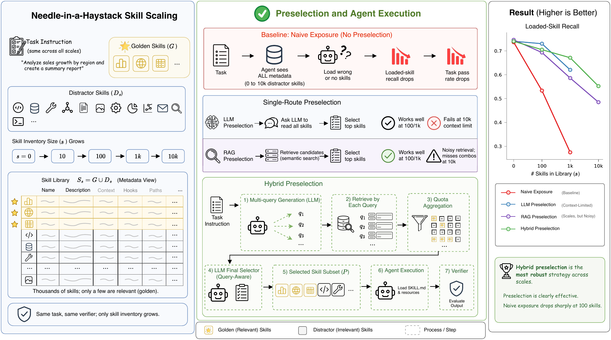
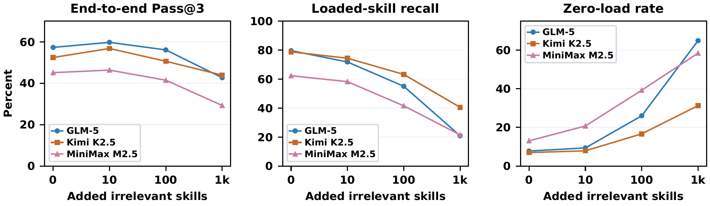
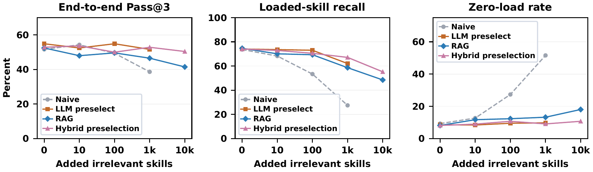

# Lost in Implicit Routing: How LLM Agents Fail to Load Relevant Skills at Scale

This repository contains the official implementation of **Lost in Implicit Routing: How LLM Agents Fail to Load Relevant Skills at Scale**.

We study how LLM agents use skills as their libraries grow. Agents increasingly load fewer or no skills, even when relevant skills remain available. Our experiments investigate semantic and instruction interference and evaluate explicit preselection as a practical mitigation.


**Experimental overview.** We keep the task and its relevant skills fixed while adding irrelevant skills, and compare implicit routing with LLM, RAG, and hybrid preselection.

---

## Requirements

- Python 3.10 or newer is recommended.
- Docker Engine with a Linux container backend for task execution.
- An OpenAI-compatible chat API; the experiments use Tencent TokenPlan.
- Qwen `text-embedding-v4` access or a matching embedding cache for RAG-based methods.

Install the dependencies:

```bash
python3 -m venv .venv
source .venv/bin/activate
pip install -r skills_scaling_study/requirements.txt
```

Configure your API credentials locally in `skills_scaling_study/.env`, using `.env.example` as a template. Do not commit credentials. See the [reproduction guide](docs/REPRODUCIBILITY.md) for setup details.

## Benchmark and Skills

We use [SkillsBench](https://github.com/benchflow-ai/skillsbench) and a collection of 21,262 third-party skills. The benchmark version and task list are recorded in [the benchmark manifest](manifests/benchmark.json).

**Due to licensing restrictions on some third-party skills, we do not redistribute the collected skills or provide scripts to download them directly. Readers who need these skills may use our recorded source links to obtain them independently, subject to the applicable upstream licenses and access conditions.**

- [Skill source links](docs/SKILL_SOURCES.md): 670 recorded GitHub repositories.
- [Per-skill source index](manifests/skill_sources.jsonl): identifiers, source links, and content hashes.
- [Unresolved sources](manifests/unresolved_sources.json): 474 entries without recorded sources.

These links point to external repositories, which may have changed since our experiments. See [Data and Licenses](docs/DATA_AND_LICENSES.md) for the source-list format.

## Running Experiments

First, run the offline tests:

```bash
python scripts/check_source_index.py
cd skills_scaling_study
python -B -m unittest -v test_routing
```

After preparing the benchmark, skills, and API credentials, preview an experiment:

```bash
python run_study.py \
  --strategy naive \
  --models glm-5 \
  --tasks adaptive-cruise-control \
  --counts 0 \
  --passes 1
```

This command only previews the configuration. Add `--run` to execute it. Start with a single-task smoke test and inspect the saved skill context before launching larger experiments.

**Key arguments:**

- `--strategy`: `naive`, `llm`, `rag`, or `multi-query-rag-llm` (hybrid).
- `--counts`: Number of additional irrelevant skills.
- `--passes`: Number of repetitions.
- `--max-parallel`: Concurrent tasks, from 1 to 4; choose a value that fits the Docker host's CPU and memory limits.
- `--output-dir`: Directory for experiment logs and results.

For field-level masking, plan-first prompting, embedding preparation, and resume behavior, see the [full experiment instructions](docs/REPRODUCIBILITY.md).

## Results


**Implicit routing becomes unreliable at scale.** Across the main evaluation, adding 1,000 irrelevant skills reduces loaded-skill recall from 73.6% to 27.4% and increases the zero-load rate from 9.3% to 51.6%. Loading non-golden skills, including plausible alternatives, is too rare to explain this decline.


**Explicit preselection mitigates routing collapse.** We evaluate LLM, RAG, and hybrid preselection as practical baselines, including their coverage and latency trade-offs. Routing-only diagnosis measures selection from the full library; preselection-plus-execution also narrows the executor's visible library.

Field-level masking further shows that removing irrelevant descriptions largely restores skill loading. During execution, descriptions act as conditional sub-instructions alongside the task; in routing-only selection, they become semantic-matching inputs. This role shift offers a perspective on why preselection helps.

## Analysis

The repository includes scripts for context-checked skill-loading labels, non-golden similarity analysis, masking results, and preselection latency:

| Analysis | Script in `skills_scaling_study/` |
|---|---|
| Skill-loading audit | `audit_skill_loading.py` |
| Non-golden similarity | `analyze_skill_substitution.py` |
| Field-level masking | `report_masking_results.py` |
| Routing latency | `analyze_routing_latency.py` |

See the [analysis instructions](docs/REPRODUCIBILITY.md#logs-resume-and-analysis) for usage. Raw experiment logs and precomputed embeddings are not included.

## Citation

If you find this work useful, please cite:

```bibtex
@misc{liu2026lostimplicitrouting,
  title = {Lost in Implicit Routing: How LLM Agents Fail to Load Relevant Skills at Scale},
  author = {Liu, Jinlin and Chen, Wei and Zhang, Xiaojin},
  year = {2026},
  note = {Preprint}
}
```

## Acknowledgments

We thank the creators of SkillsBench and the upstream skills used in this study. Third-party materials remain subject to their original licenses. See [NOTICE](NOTICE.md) for licensing information.
